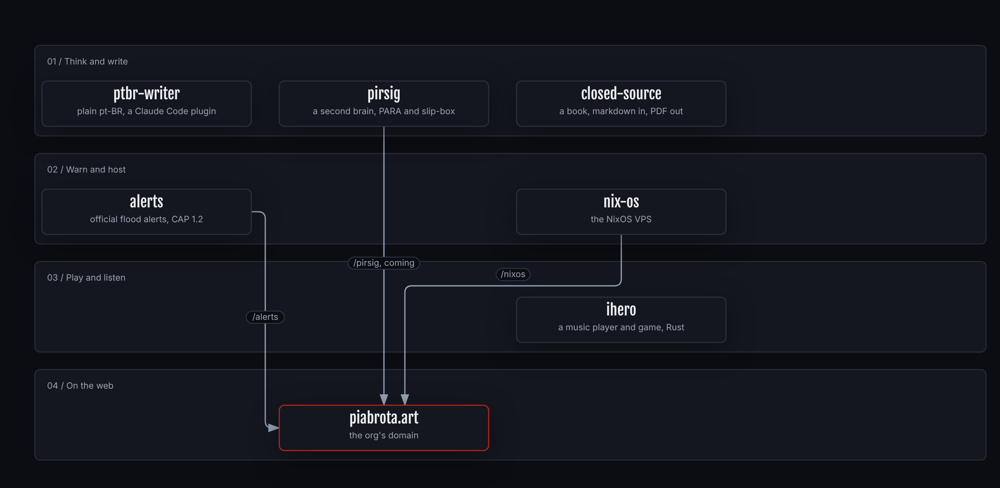

# piabrota

Open Software Fabric made in RJ · <a href="#in-one-minute">in one minute</a> · <a href="#projects">projects</a> · <a href="#how-it-fits">how it fits</a> · <a href="#partnerships">partnerships</a> · <a href="#license">license</a>

## In one minute

- **piabrota is an open software fabric, made in Rio de Janeiro.** Each project is its own
  repository, with its own README, licence and tests. The source is open, and so is the method.
- **Every project is FOSS.** Most are under the Mozilla Public License 2.0; the book's text is
  CC BY 4.0 and its code AGPL-3.0.
- **The READMEs share one discipline:** a drawing at the top, a line of links, "in one minute",
  and figures drawn from a checked source with [archify](https://github.com/piabrota/archify),
  each with a card that says how to read it.
- **The org's domain is [piabrota.art](https://piabrota.art).** Projects come to it one path at a
  time.

## Projects

| | Project | What it is | Licence |
|:---:|---|---|---|
|  | [**pirsig**](https://github.com/h0ffmann/pirsig) | A second brain: PARA and a Zettelkasten slip-box in one place. A Rust app with a desktop app, a REST API and a terminal CLI, `psg`, on one model layer. | MPL-2.0 |
|  | [**ptbr-writer**](https://github.com/h0ffmann/ptbr-writer) | Rewrites technical text in Brazilian Portuguese so that it reads once: explicit subject, one proposition per sentence. A Claude Code plugin; it marks with `⚠` what it did not check. | MPL-2.0 |
|  | [**alerts**](https://github.com/piabrota/alerts) | A generic alert platform. It collects alerts from official sources only, and delivers them to Discord and an Atom feed with CAP 1.2. The first hazard is floods in the south of Brazil. | MPL-2.0 |
|  | [**closed-source**](https://github.com/h0ffmann/closed-source) | *The god that failed*: a book on why closed source failed as a protection, for science first. Markdown in, PDF out, every reference checked, every release citable. | text CC BY 4.0, code AGPL-3.0 |
| 🎶 | **ihero** | A FOSS music player and game, in Rust. Coming. | MPL-2.0 |
| ❄️ | [**nix-os**](https://github.com/piabrota/nix-os) | The NixOS configuration of the small VPS that serves piabrota.art/nixos. Every change is judged by what it adds to the closure and to memory. | MPL-2.0 |

The drawings load from each project's repository at a pinned commit; none is copied here.

## How it fits

How to read this figure

**Takeaway.** Six open projects, each on its own; three of them meet the web at piabrota.art.

**How to read.** One lane per kind of work. An arrow means "is served at", and its label is the
path; "coming" means planned, not live. The red border marks the domain.

**Not shown.** Each project's own site on GitHub Pages, and the tools they share: Nix, Rust,
archify.

**Evidence.** [`archify/fabric.json`](archify/fabric.json), the source of the figure. The paths
come from alerts' `docs/HOSPEDAGEM.md` (`/alerts`), nix-os' `AGENTS.md` (`/nixos`) and pirsig's
README, "Ways to run Pirsig" (`/pirsig`, coming).

`just figure` draws it again with the pinned archify; `just figure-check` says whether the PNG is
stale.

## Partnerships

Partnership requests: mhoffmannfs [at] gmail.com.

## How to cite

The works with a DOI, by Matheus Hoffmann:

- marola: [10.5281/zenodo.23224155](https://doi.org/10.5281/zenodo.23224155)
- ww3-gpu: [10.5281/zenodo.23221351](https://doi.org/10.5281/zenodo.23221351)
- picasso: [10.5281/zenodo.23311208](https://doi.org/10.5281/zenodo.23311208)
- closed source: [10.5281/zenodo.23333656](https://doi.org/10.5281/zenodo.23333656)
- marola-bench: [10.5281/zenodo.23352633](https://doi.org/10.5281/zenodo.23352633)
- nashkell, the open book: [10.5281/zenodo.23356739](https://doi.org/10.5281/zenodo.23356739)

## License

This repository is under the [Mozilla Public License 2.0](../LICENSE). Each project has its own
licence, named in the table above. The PIABROTA name and logo are the org's marks and are not
under that licence.
